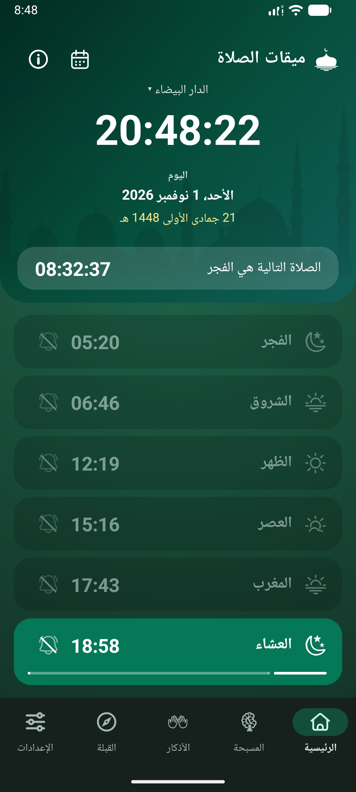
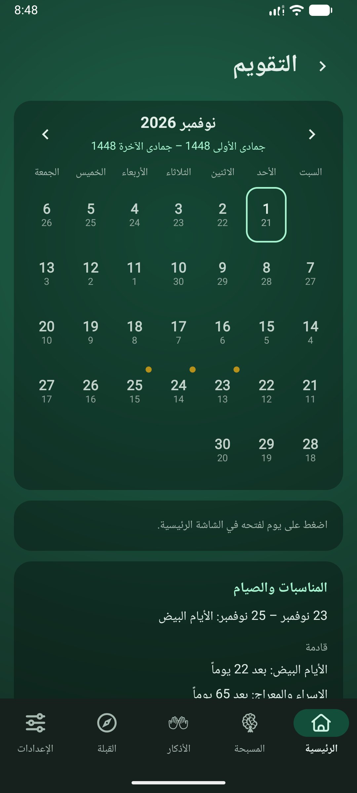
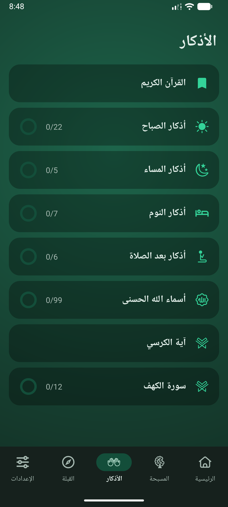
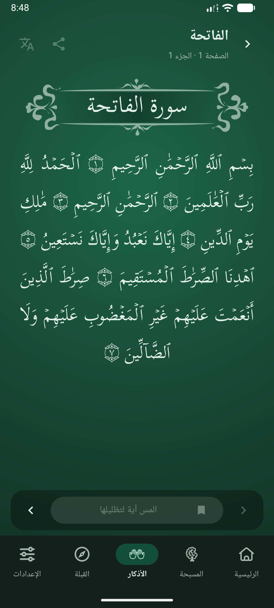

# ميقات الصلاة

أوقات الصلاة، سجل الصيام، الأذكار، القبلة، والقرآن الكريم في تطبيق أندرويد مجاني يعمل بدون إنترنت. بدون حساب، بدون إعلانات، بدون تتبع، وبدون إذن الإنترنت: لا شيء يغادر الهاتف.

  
  
  
  

## الميزات

- **أوقات الصلاة** لصلاة الفجر، الشروق، الظهر، العصر، المغرب، العشاء، بناءً على الحسابات الفلكية الخاصة بالتطبيق. يتضمن ست طرق حساب (منها طريقة الوزارة المغربية)، حساب العصر بالطريقة القياسية أو الحنفية، الارتفاع، تعديل الدقائق لكل صلاة على حدة، وتاريخ هجري مع إمكانية تصحيحه لغاية يومين.
- **التقويم**: عرض الشهر مع التواريخ الهجرية والمناسبات الإسلامية.
- **سجل الصيام والمناسبات الإسلامية**: رمضان مع أيام القضاء، العيد، عرفة، عاشوراء، الأيام البيض والمزيد، مع تنبيه في ليلة اليوم السابق.
- **التنبيهات**: تنبيهات في وقت الصلاة وقبلها، إشعار صلاة واحد يبقى حتى تؤكده، تذكير بسورة الكهف يوم الجمعة، صوت في الوضع الصامت مع ملف صوتي من اختيارك، وفحص صحة التنبيهات الذي يوضح ما يمنع الإشعارات وكيفية إصلاحه.
- **السبحة** بحلقات تسبيح مكونة من 33 / 33 / 33 / 1 خرزة.
- **الأذكار**: أذكار الصباح والمساء، النوم، أذكار ما بعد الصلاة، الأسماء الحسنى، آية الكرسي، وسورة الكهف.
- **قارئ القرآن** مع ميزة البحث بالاسم أو الآية (`2:255`)، المشاركة، والترجمات الإنجليزية والفرنسية من موقع QuranEnc.
- **بوصلة القبلة** و**ودجت للشاشة الرئيسية** تعرض الصلاة القادمة.
- **اللغات: الإنجليزية، الفرنسية، والعربية** (من اليمين لليسار)، 13 لوحة ألوان، ووضع مظلم تلقائي.

## الدليـــل

| للغرض | اقرأ |
|---|---|
| استخدام التطبيق | دليل المستخدم: [الإنجليزية](user-guide/en.md)، [الفرنسية](user-guide/fr.md)، [العربية](user-guide/ar.md) |
| الخصوصية | سياسة الخصوصية: [الإنجليزية](privacy-policy/en.md)، [الفرنسية](privacy-policy/fr.md)، [العربية](privacy-policy/ar.md) |

## الخصوصية باختصار

كل ما يخزنه التطبيق (الإعدادات، المكان المحدد، سجلات الصلوات والصيام، تقدم الأذكار والقرآن) يبقى بالكامل على جهازك. التطبيق لا يطلب إذن الاتصال بالإنترنت. تحديد الموقع اختياري ويتم استخدامه على الجهاز فقط. راجع [سياسة الخصوصية](privacy-policy/ar.md) لمزيد من التفاصيل.

## المصادر والاعتمادات

- نص القرآن وتخطيط الصفحات: منصة المطورين بمجمع الملك فهد لطباعة المصحف الشريف؛ وفي التطبيق، قسم *المصادر والترخيص* (حول التطبيق) يعرض كل مصدر مع ترخيصه الخاص.
- الترجمات: الترجمة الإنجليزية `english_saheeh` والفرنسية `french_rashid` من موقع [QuranEnc.com](https://quranenc.com)، وقد أعيد نشرها دون تعديل وفقاً لشروطهم.
- خط النص العربي: Scheherazade New (برخصة SIL Open Font License 1.1).
- جداول مرجعية لأوقات الصلاة في المغرب: وزارة الأوقاف والشؤون الإسلامية (تُستخدم فقط لاختبار دقة الحساب).

يتم حساب أوقات الصلاة وقد تختلف قليلاً عن مسجدك المحلي؛ ويمكن تعديل كل صلاة ببضع دقائق. النصوص الفرنسية والعربية المكتوبة للتطبيق يُفضل مراجعتها من قبل متحدث أصلي للغة قبل الاعتماد عليها كلياً.

## الاتصال

منير بنحجاج، [miqatalsalat@gmail.com](mailto:miqatalsalat@gmail.com). تحتوي شاشة "حول" في التطبيق على رابط "إرسال ملاحظة".

## الترخيص

لم يتم اختيار رخصة مفتوحة المصدر للشفرة البرمجية بعد، لذلك جميع الحقوق محفوظة. تحتفظ المواد التابعة لجهات خارجية برخصها الخاصة، المذكورة أعلاه وفي التطبيق.
