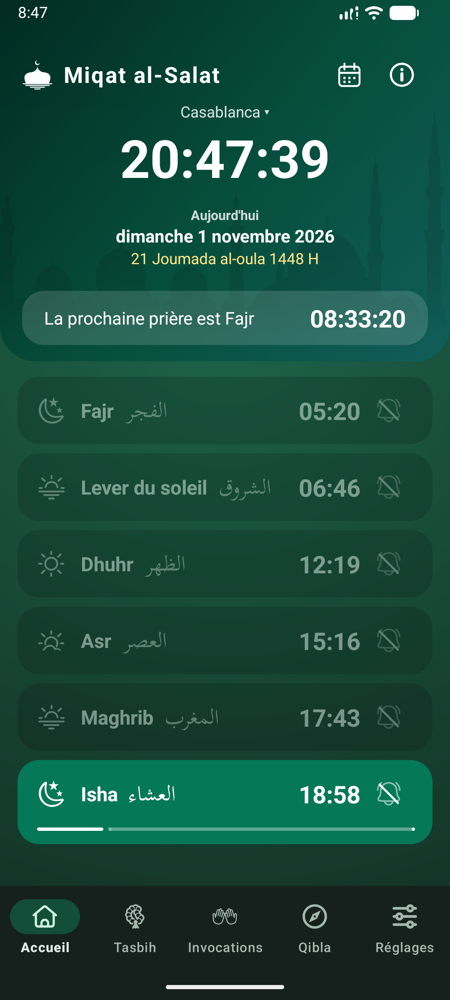
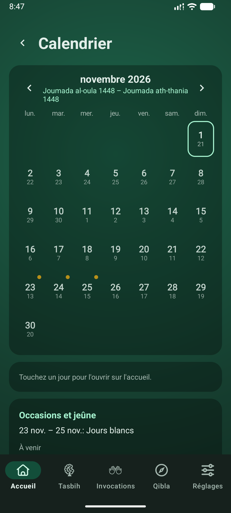
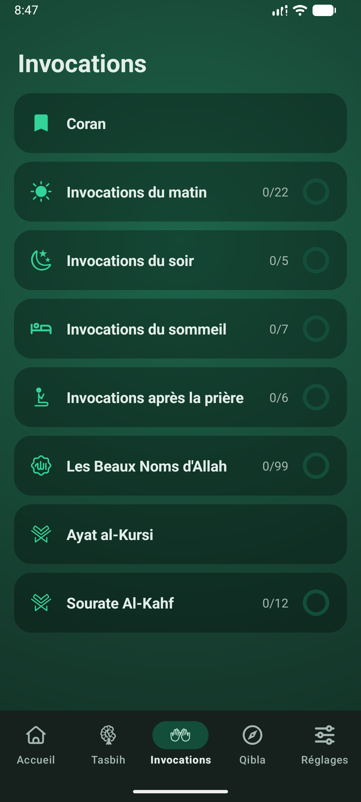
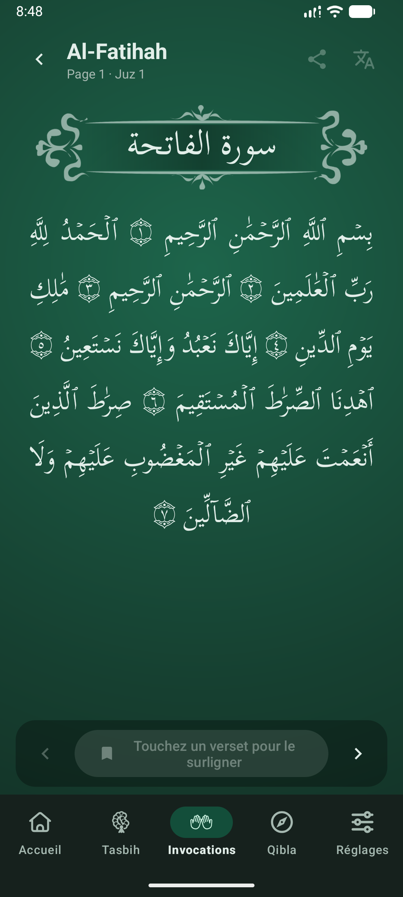

# Miqat al-Salat

Horaires de prière, journal de jeûne, évocations (Dhikr), Qibla et Coran, dans une application Android gratuite qui fonctionne hors ligne. Aucun compte, aucune publicité, aucun pistage, et aucune permission Internet : rien ne quitte le téléphone.

  
  
  
  

## Fonctionnalités

- **Horaires de prière** pour Fajr, le Lever du soleil, Dhuhr, Asr, Maghrib et Isha, calculés par les algorithmes astronomiques de l'application. Six méthodes (dont celle du ministère marocain), Asr standard ou Hanafi, élévation, ajustements à la minute par prière et date hégirienne avec correction jusqu'à deux jours.
- **Calendrier** : une vue du mois avec les dates hégiriennes et les occasions islamiques.
- **Journal de jeûne et occasions islamiques** : Ramadan avec jours de rattrapage, Aïd, Arafah, Achoura, les Jours Blancs (Ayyam al-Bid) et plus encore, avec un rappel la veille au soir.
- **Alertes** : rappels à l'heure et en amont, une seule notification de prière qui reste jusqu'à votre confirmation, Sourat Al-Kahf le vendredi, son en mode silencieux avec votre propre fichier audio, et un bilan de santé des alertes qui indique ce qui bloque les notifications et comment y remédier.
- **Tasbih** avec un anneau de perles de 33 / 33 / 33 / 1.
- **Dhikr** : invocations du matin, du soir, du sommeil et après la prière, les 99 Noms d'Allah, Ayat al-Kursi et Sourat Al-Kahf.
- **Lecteur du Coran** avec recherche par nom ou verset (`2:255`), partage, et traductions anglaise et française de QuranEnc.
- **Boussole de la Qibla** et un **widget d'écran d'accueil** pour la prochaine prière.
- **Anglais, français et arabe** (de droite à gauche), 13 palettes de couleurs et un thème sombre automatique.

## Documentation

| Pour | Lire |
|---|---|
| Utiliser l'application | Guide utilisateur : [Anglais](user-guide/en.md), [Français](user-guide/fr.md), [العربية](user-guide/ar.md) |
| Confidentialité | Politique de confidentialité : [Anglais](privacy-policy/en.md), [Français](privacy-policy/fr.md), [العربية](privacy-policy/ar.md) |

## Confidentialité en bref

Tout ce que l'application stocke (paramètres, lieu choisi, journaux de prière et de jeûne, progression du dhikr et du Coran) reste sur l'appareil. L'application ne déclare pas la permission Internet. La localisation est facultative et utilisée uniquement sur l'appareil. Consultez la [politique de confidentialité](privacy-policy/fr.md) pour plus de détails.

## Sources et crédits

- Texte du Coran et mise en page : plateforme développeur du Complexe King Fahd pour l'Impression du Saint Coran ; dans l'application, *Sources et licences* (À propos) liste chaque source avec sa licence.
- Traductions : Anglais `english_saheeh` et Français `french_rashid` provenant de [QuranEnc.com](https://quranenc.com), republiées sans modification selon leurs conditions.
- Police du texte arabe : Scheherazade New (SIL Open Font License 1.1).
- Tables de référence des horaires de prière marocains : Ministère des Habous et des Affaires Islamiques (utilisé uniquement pour tester le calcul).

Les horaires de prière sont calculés et peuvent différer légèrement de votre mosquée locale ; chaque prière peut être ajustée de quelques minutes. La formulation française et arabe rédigée pour l'application doit être vérifiée par un locuteur natif avant d'y fier pleinement.

## Contact

Mounir BENHAJJAJ, [miqatalsalat@gmail.com](mailto:miqatalsalat@gmail.com). L'écran À propos de l'application dispose d'un lien « Envoyer un commentaire ».

## Licence

Aucune licence open-source n'a encore été choisie pour le code source, tous les droits sont donc réservés. Le matériel tiers conserve ses propres licences, énumérées ci-dessus et dans l'application.
