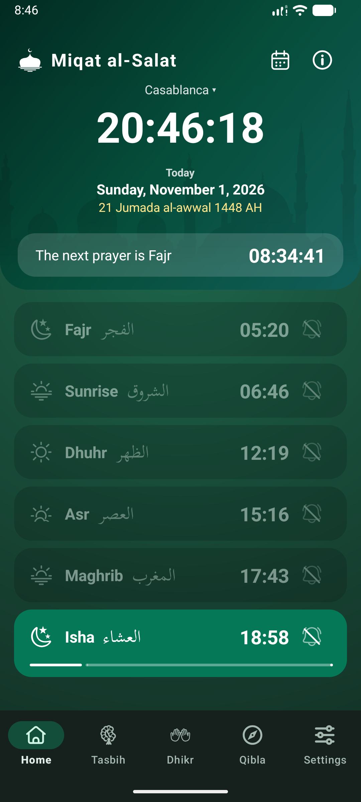
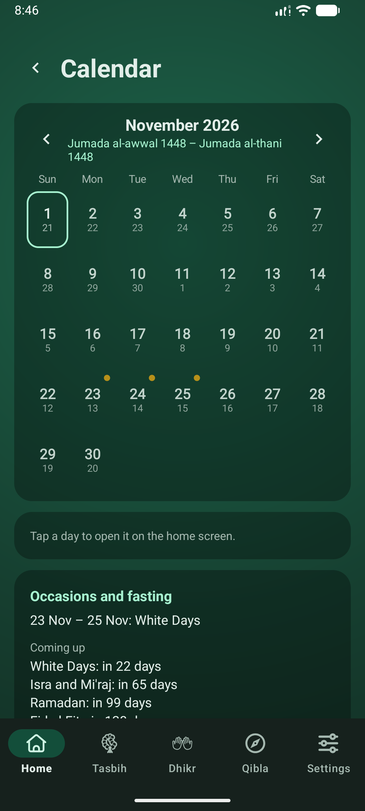
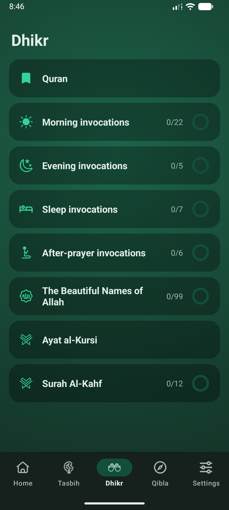
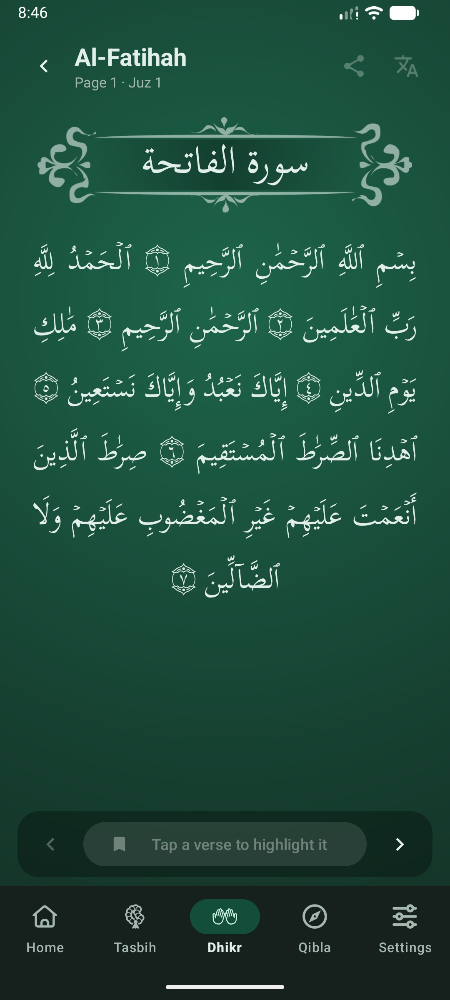

# Miqat al-Salat

Prayer times, a fasting log, remembrance, the Qibla and the Quran, in one free Android app that works
offline. No account, no ads, no analytics, and no internet permission: nothing leaves the phone.

  
  
  
  

## Features

- **Prayer times** for Fajr, Sunrise, Dhuhr, Asr, Maghrib and Isha, from
  the app's own astronomical calculation. Six methods (including the Moroccan ministry's), standard or Hanafi Asr,
  elevation, per-prayer minute adjustments and a Hijri date with a correction of up to two days.
- **Calendar**: a month view with the Hijri dates and the Islamic occasions.
- **Fasting log and Islamic occasions**: Ramadan with make-up days, Eid, Arafah, Ashura, the White Days and more, with
  an evening-before reminder.
- **Alerts**: on-time and lead reminders, one prayer notification that stays until you confirm it, Surah Al-Kahf on Fridays, sound on silent mode with your own audio file, and an alert health
  check that shows what is blocking notifications and how to fix it.
- **Tasbih** with a 33 / 33 / 33 / 1 bead ring.
- **Dhikr**: morning, evening, sleep and after-prayer invocations, the 99 Beautiful Names, Ayat al-Kursi and Surah
  Al-Kahf.
- **Quran** reader with search by name or verse (`2:255`), sharing, and English and French translations from
  QuranEnc.
- **Qibla** compass and a **home-screen widget** for the next prayer.
- **English, French and Arabic** (right to left), 13 colour palettes and an automatic dark theme.

## Documentation

| For | Read |
|---|---|
| Using the app | User guide: [English](user-guide/en.md), [Français](user-guide/fr.md), [العربية](user-guide/ar.md) |
| Privacy | Privacy policy: [English](privacy-policy/en.md), [Français](privacy-policy/fr.md), [العربية](privacy-policy/ar.md) |

## Privacy in short

Everything the app stores (settings, chosen place, prayer and fasting logs, dhikr and Quran progress) stays on the
device. The app does not declare the internet permission. Location is optional and used on the device only. See the
[privacy policy](privacy-policy/en.md) for details.

## Sources and credits

- Quran text and page layout: King Fahd Glorious Quran Printing Complex developer platform; in the app, *Sources and
  licenses* (About) lists each source with its licence.
- Translations: English `english_saheeh` and French `french_rashid` from [QuranEnc.com](https://quranenc.com),
  republished unchanged under its terms.
- Arabic text font: Scheherazade New (SIL Open Font License 1.1).
- Moroccan prayer-time reference tables: Ministry of Habous and Islamic Affairs (used only to test the calculation).

Prayer times are calculated and may differ slightly from your local mosque; each prayer can be adjusted by a few
minutes. The French and Arabic wording written for the app should be read by a native speaker before it is relied on.

## Contact

Mounir BENHAJJAJ, [miqatalsalat@gmail.com](mailto:miqatalsalat@gmail.com). The app's About screen has a "Send feedback" link.

## License

No open-source licence has been chosen for the source code yet, so all rights are reserved. Third-party material keeps
its own licences, listed above and in the app.
