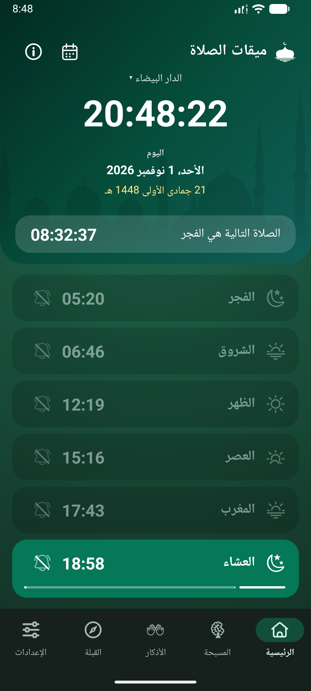
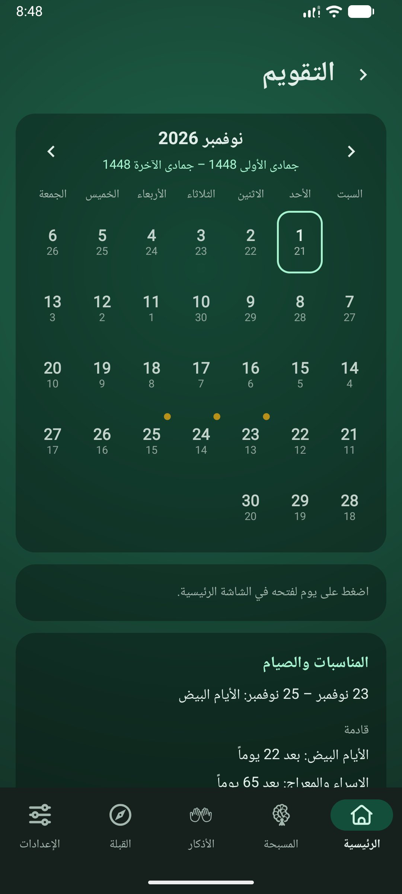
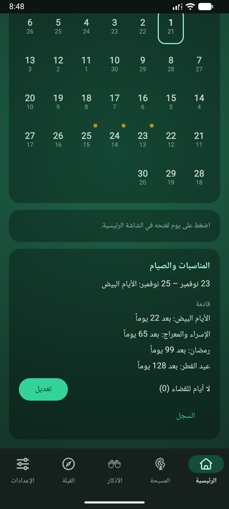
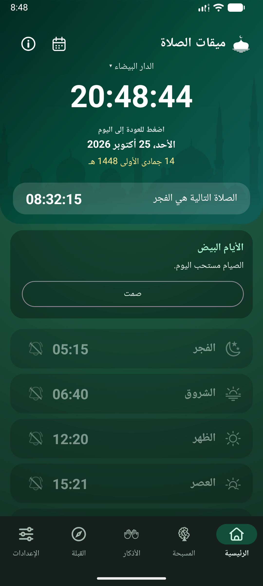
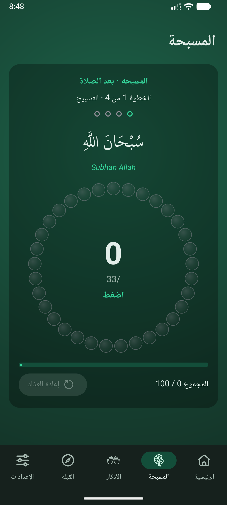
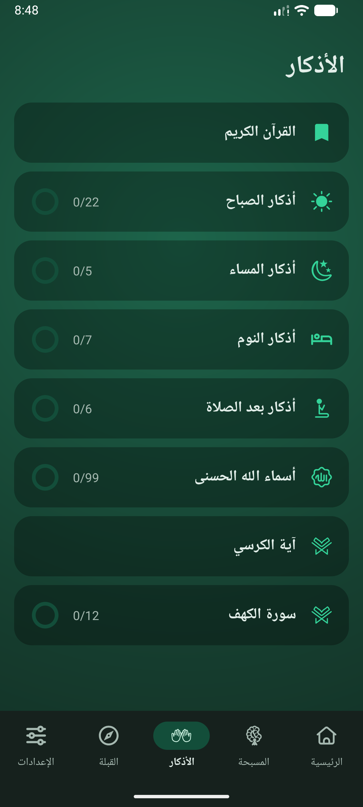
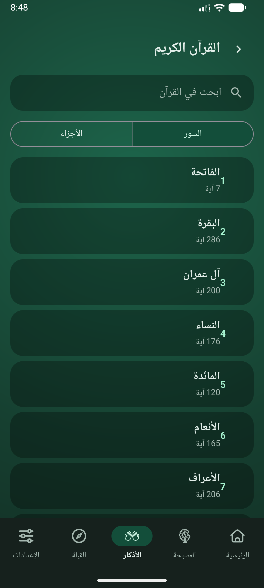
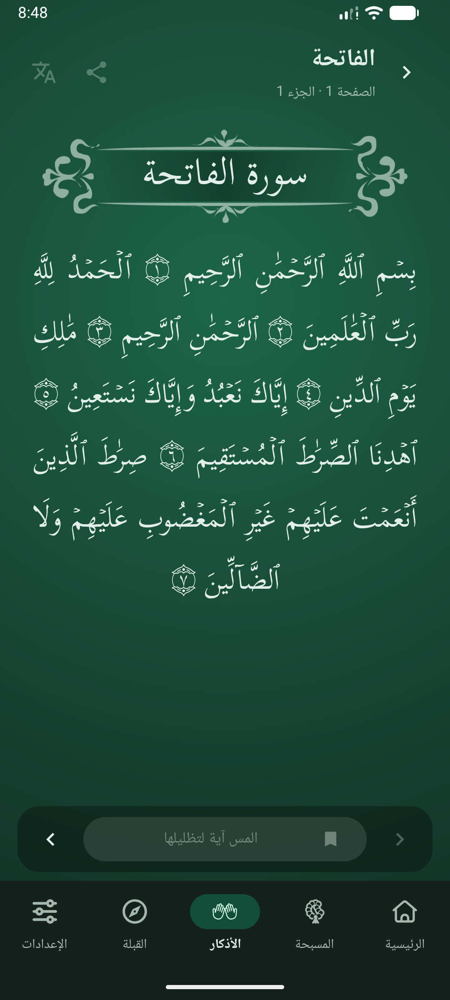
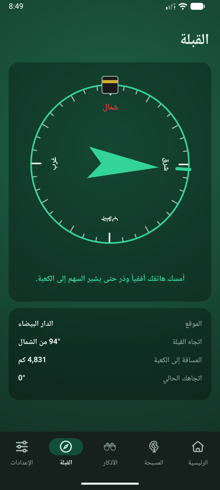
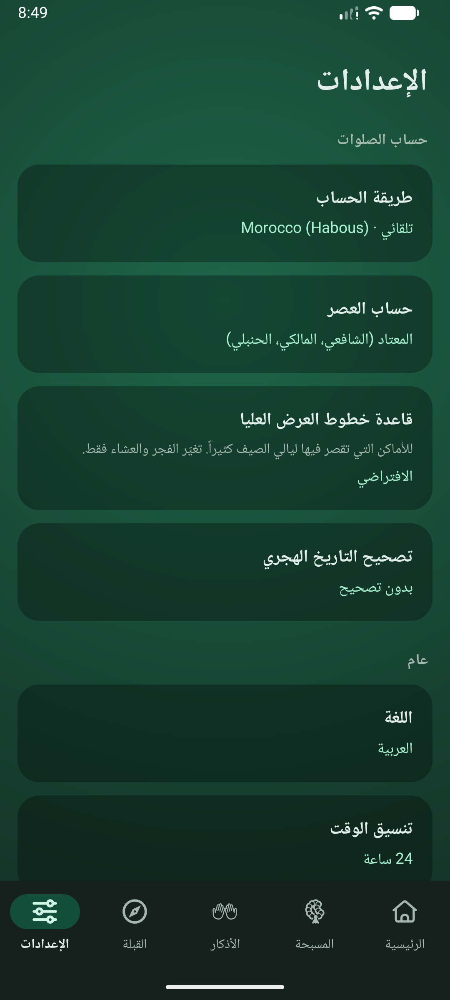

# دليل استخدام ميقات الصلاة

مواقيت الصلاة، وسجل الصيام، والأذكار، والقبلة، والقرآن، كلها على هاتفك. لا يغادر شيء جهازك ولا يوجد حساب.

## الرئيسية: صلوات اليوم

يعرض التبويب الأول ما يهمك الآن: الساعة والتاريخ (وتحته التاريخ الهجري) والعدّ التنازلي إلى الصلاة القادمة.

- **صفوف الصلوات**: الفجر والشروق والظهر والعصر والمغرب والعشاء. يُبرَز صف الصلاة الحالية بشريط يبيّن ما بقي من وقتها.
- **أيام أخرى**: اسحب يميناً أو يساراً لرؤية اليوم التالي أو السابق. المس التاريخ للعودة إلى اليوم.
- **المكان**: المس اسم المدينة في الأعلى لاختيار مدينة أخرى أو استخدام موقعك الحالي.
- **شريط الكهف**: من غروب الخميس إلى غروب الجمعة يقترح عليك تذكير بفتح سورة الكهف.
- يفتح زر التقويم صفحة التقويم، ويعرض زر **i** صفحة «حول» مع تنبيه المواقيت ورابط لإرسال ملاحظاتك.

> **نصيحة.** المس **وقت** الصلاة لتصحيحه بدقائق قليلة، مثلاً ليوافق مسجدك.

## إشعار الصلاة

- عند بدء الصلاة يصلك إشعار واحد. كل إشعار جديد يحلّ محل السابق، فلا يظهر على الشاشة سوى واحد.
- يبقى إشعار الصلاة ظاهراً حتى تضغط **صليت** أو تضغط على الإشعار أو تفتح الشاشة الرئيسية في التطبيق؛ وإن كانت الرئيسية مفتوحة عند وصوله زال بعد ثوانٍ. لا يُسجَّل شيء: هو مجرد تذكير.
- المس **الجرس** لتختار هل تُنبَّه لهذه الصلاة.
- الشروق والتذكير قبل الصلاة إشعاران عاديان يمكنك إزالتهما بالسحب.

## التقويم

شهر كامل في نظرة. تحت رقم كل يوم اليوم الهجري.

- استخدم السهمين لتغيير الشهر، والمس يوماً لفتحه في الرئيسية.
- 🟡 **نقطة ذهبية** أعلى اليمين تدل على مناسبة إسلامية (انظر الصيام).
- علامة صغيرة أعلى اليسار تبيّن صيام اليوم: 🟢 صيام، 🔵 قضاء، و⭕ حلقة حمراء ليوم من رمضان لم يُصَم.
- تحت الجدول: بطاقة المناسبات.

 

## المناسبات والصيام

يعلّم التطبيق هذه المواعيد من التقويم الإسلامي: رمضان، وعيد الفطر، وعيد الأضحى، ورأس السنة الهجرية، وعاشوراء، والمولد النبوي، والإسراء والمعراج، ويوم عرفة، والأيام البيض (13 و14 و15 من كل شهر). يظهر المولد النبوي والإسراء والمعراج تاريخاً فقط.

- في أيام **رمضان** تعرض بطاقة الرئيسية رقم اليوم مع **صمت** و**لم أصم**. اليوم الذي لم يُصَم يُضاف إلى الأيام التي عليك قضاؤها.
- في الأيام المستحبة (عرفة وعاشوراء والأيام البيض) تعرض البطاقة **صمت**.
- في العيدين والأيام الثلاثة بعد عيد الأضحى تذكر البطاقة أن الصيام غير جائز ولا تعرض شيئاً للتسجيل.
- عندما تكون عليك أيام، يسجّل **قضيت يوماً** يوماً واحداً في أي يوم عادي وينقص العدد.
- المس الزر مرة أخرى للتراجع. لا يمكن تسجيل الأيام المقبلة.
- في التقويم يتيح **تعديل** إضافة أيام مستحقة من سنوات سابقة (أو إنقاص بعضها).
- في التقويم يعرض **السجل** لكل سنة هجرية الأيام التي صمتها وقضيتها وفاتتك.
- يصلك تذكير مساء اليوم السابق لأول أيام رمضان ويوم عرفة وعاشوراء وكل يوم من الأيام البيض. يمكنك إيقافه من الإعدادات.

> **نصيحة.** يتبع التاريخ الهجري تقويم أم القرى. إذا كان بلدك يبدأ الشهر قبل يوم أو بعده فاضبط تصحيح التاريخ الهجري في الإعدادات فتتبعه كل التواريخ هنا.

## المسبحة

مسبحة للعدّ. المس لتتقدم خرزة واحدة. تمرّ الدائرة على 33 ثم 33 ثم 33 ثم 1، ويُحفظ عدّك.

## الأذكار

قوائم أذكار فيها دائرة تمتلئ كلما تقدمت. افتح قائمة واقرأ كل ذكر ثم انتقل إلى التالي.

- أذكار **الصباح** و**المساء** و**النوم** و**بعد الصلاة**، و**أسماء الله الحسنى التسعة والتسعون**.
- تبدأ القوائم اليومية من جديد عند المغرب.
- تُفتح **آية الكرسي** و**سورة الكهف** في قارئ القرآن مقتصرتين على الآية أو السورة. تُحسب الكهف في 12 جزءاً وتبدأ من جديد كل مساء خميس.
- تفتح بطاقة **القرآن** في الأعلى المصحف كاملاً.

## القرآن

- اختر سورة أو جزءاً من القائمة أو ابحث. بحث مثل **2:255** ينقلك مباشرة إلى تلك الآية.
- اسحب أو استخدم السهمين لتقليب الصفحات. الخط كبير ويُرتَّب ليناسب عرض هاتفك.
- **المس آية** لتظليلها. يمكنك بعد ذلك مشاركتها، أو الضغط على زر الترجمة لقراءتها بالإنجليزية أو الفرنسية مع مصدرها.
- يُحفظ المكان الذي توقفت عنده.

> **نصيحة.** يبقى زر الترجمة رمادياً حتى تحدد آية.

 

## القبلة

بوصلة تشير إلى الكعبة من مكانك. أمسك الهاتف مستوياً؛ يدور السهم كلما دُرت. ابتعد عن المعادن والمغانط، وحرّك الهاتف على شكل ثمانية إذا طلب المعايرة.

## الإعدادات

- **الحساب**: الطريقة (ومنها طريقة وزارة الأوقاف المغربية)، والعصر القياسي أو الحنفي، وقاعدة لليالي الصيف القصيرة جداً (بعيداً عن خط الاستواء)، وتصحيح التاريخ الهجري.
- **اللغة**: الإنجليزية أو الفرنسية أو العربية (من اليمين إلى اليسار).
- **المظهر**: لوحة الألوان، والمظهر الداكن، وخيار تغيير لون التمييز بحسب وقت اليوم.
- **التنبيهات**: انظر أدناه.
- **متقدم**: الارتفاع، وتعديل بالدقائق لكل صلاة.

تعرض **أداة** الشاشة الرئيسية الصلاة القادمة؛ أضفها من قائمة الأدوات في هاتفك.

## التنبيهات

- **تنبيهات الصلاة** عند كل وقت صلاة، وتذكير اختياري قبلها بدقائق.
- تذكيرات **الكهف** مساء الخميس وبعد ظهر الجمعة ما لم تكن قد قرأتها.
- تذكيرات **الصيام** مساء اليوم السابق لرمضان وعرفة وعاشوراء والأيام البيض.
- يُشغّل مفتاح **سجل الصيام** في الإعدادات أزرار الصيام وعلامات التقويم أو يوقفها؛ وتبقى المناسبات.
- يعرض مفتاح **صيام التطوع** (متوقف افتراضياً) زر «صمت» أيضاً يومي الاثنين والخميس وأيام شوال بعد العيد.
- **تصدير سجل الصيام** يحفظه في ملف تحتفظ به أو تنقله إلى هاتف آخر؛ و**استيراد سجل الصيام** يستبدل السجل الحالي بملف كهذا بعد السؤال.
- **الصوت في الوضع الصامت** يشغّل تنبيهات الصلاة حتى عندما يكون الهاتف صامتاً أو على الاهتزاز (متوقف افتراضياً).
- **صوت التنبيه** يتيح اختيار ملف صوتي من هاتفك (حتى 10 ميغابايت) لتنبيهات الصلاة، والاستماع إليه، أو العودة إلى الصوت الافتراضي.
- لكل نوع مفتاحه الخاص. يفتح **الصوت والاهتزاز** صفحة الصوت في الهاتف.
- إذا بدت التنبيهات متأخرة أو غائبة فإن قائمة موثوقية التنبيهات في الإعدادات تبيّن ما يعطلها (الإذن أو المنبهات الدقيقة أو توفير البطارية) مع زر لإصلاح كل منها.

> **نصيحة.** المواقيت محسوبة وقد تختلف قليلاً عن مسجدك. عدّل الصلاة بدقائق إن لزم.
