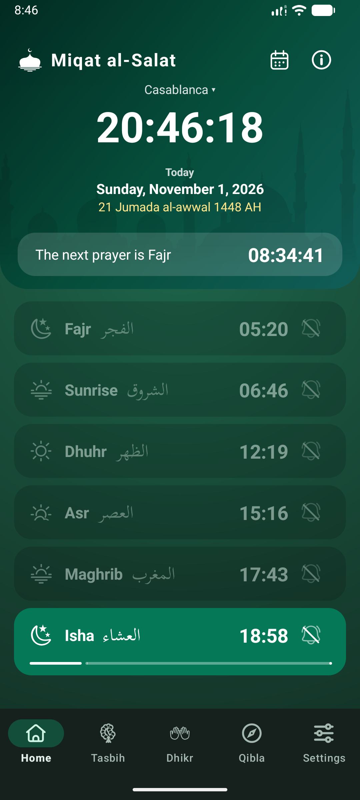
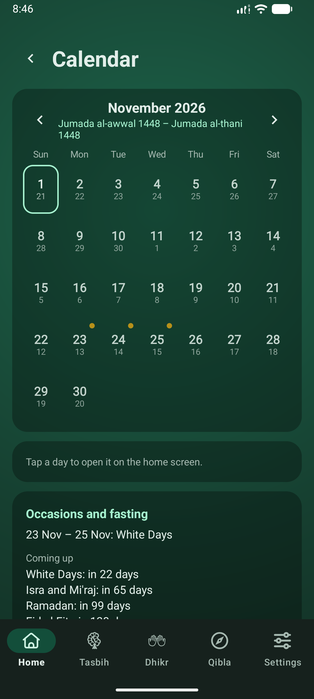
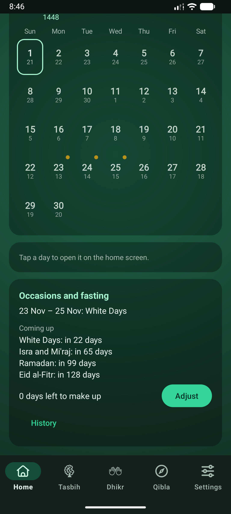
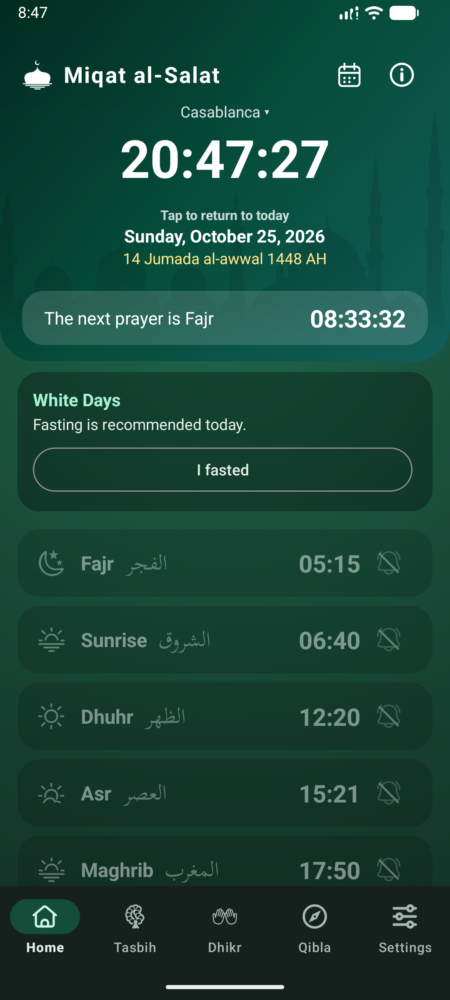
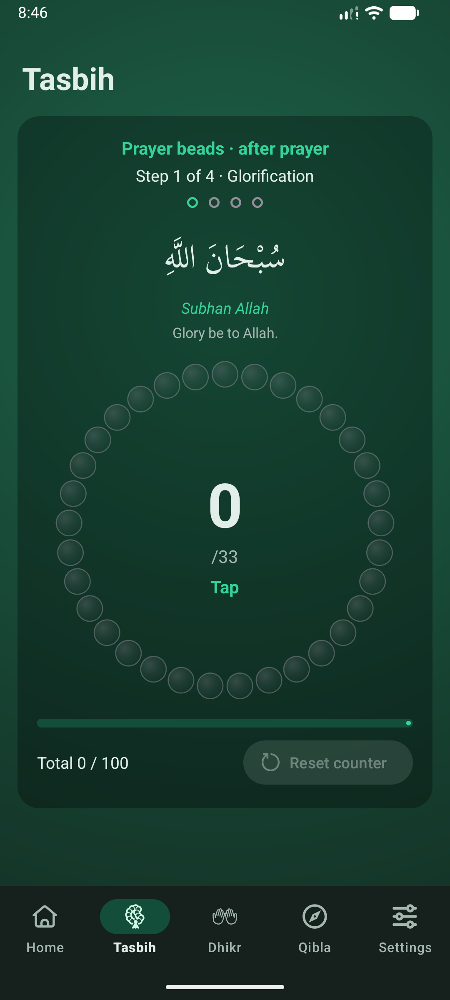
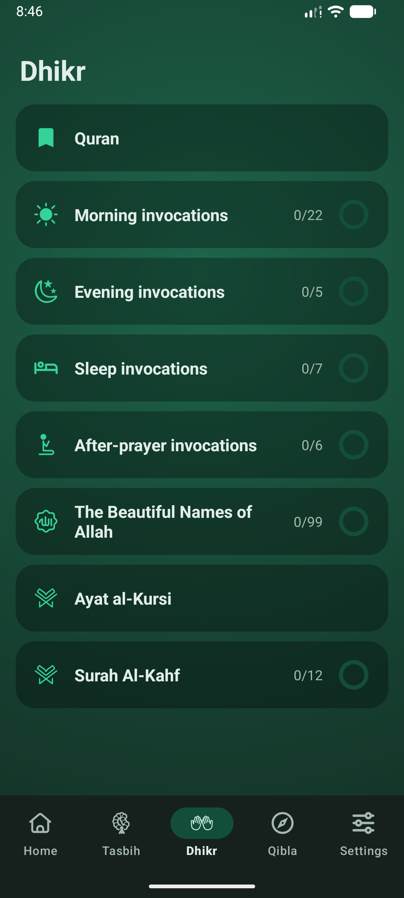
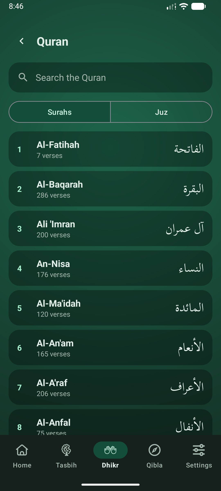
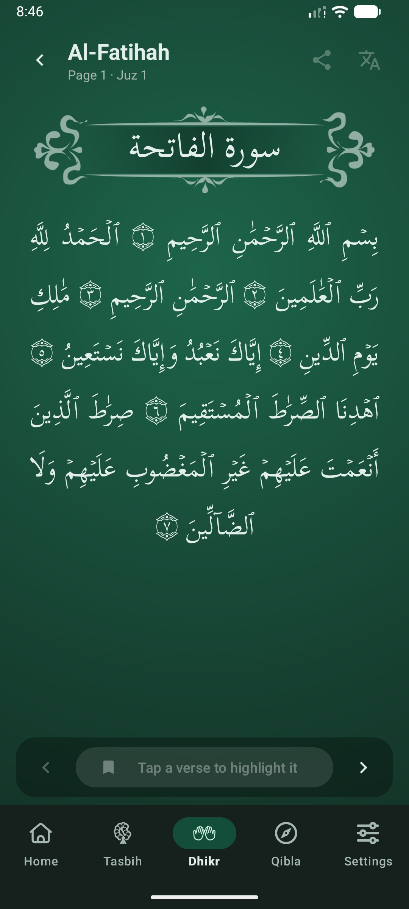
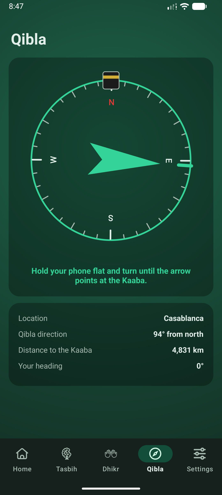
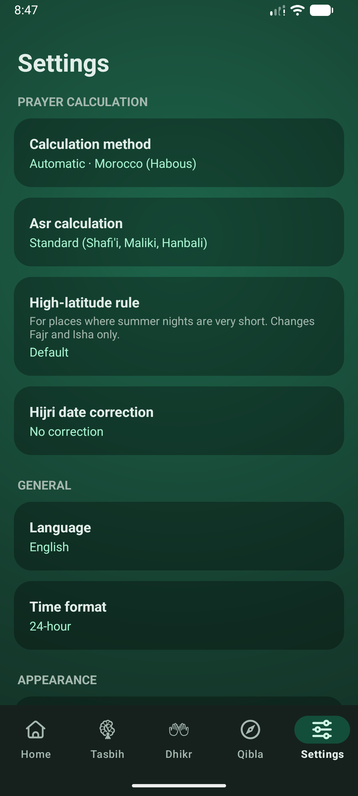

# Miqat al-Salat user guide

Prayer times, a fasting log, remembrance, the Qibla and the Quran, all on your phone. Nothing leaves your device and there is no account.

## Home: today's prayers

The first tab shows what matters now: the time, the date (with the Hijri date under it), and a countdown to the next prayer.

- **Prayer rows**: Fajr, Sunrise, Dhuhr, Asr, Maghrib and Isha. The row of the current prayer is highlighted with a bar showing how much of its time is left.
- **Other days**: swipe left or right to see the next or previous day. Tap the date to come back to today.
- **Place**: tap the city name at the top to choose another city or use your current location.
- **Al-Kahf banner**: from Thursday sunset until Friday sunset a reminder offers to open Surah Al-Kahf.
- The calendar button opens the Calendar; the **i** button shows About, with the prayer-time notice and a feedback link.

> **Tip.** Tap the **time** of a prayer to correct it by a few minutes, for example to follow your local mosque.

## The prayer notification

- When a prayer starts you get one notification. Each new one replaces the one before it, so only one is ever on screen.
- The notification of a prayer stays until you tap **I prayed**, tap the notification, or open the app on Home; if Home is already open when it arrives, it goes away after a few seconds. Nothing is recorded: it is only a reminder.
- Tap the **bell** to choose whether that prayer gives an alert.
- Sunrise and the reminder before a prayer are ordinary notifications that you can swipe away.

## Calendar

A month at a glance. Under each day number is the Hijri day.

- Use the arrows to change month; tap a day to open it on Home.
- A 🟡 **gold dot** at the top right marks an Islamic occasion (see Fasting).
- A small mark at the top left shows the fast of that day: 🟢 fasted, 🔵 made up, and a ⭕ red ring for a Ramadan day not fasted.
- Below the grid: the occasions card.

 

## Occasions and fasting

The app marks these dates of the Islamic calendar: Ramadan, Eid al-Fitr, Eid al-Adha, Islamic New Year, Ashura, Mawlid, Isra and Mi'raj, the Day of Arafah and the White Days (13th, 14th and 15th of each month). Mawlid and Isra and Mi'raj are shown as dates only.

- On **Ramadan** days the Home card shows the day number with **I fasted** and **Did not fast**. A day not fasted is added to the days you owe.
- On recommended days (Arafah, Ashura, White Days) the card offers **I fasted**.
- On the Eids and the three days after Eid al-Adha, the card says fasting is not permitted and offers nothing to record.
- When you owe days, **I made up a day** records one on any ordinary day and lowers the count.
- Tap a button again to undo it. Future days cannot be recorded.
- In the Calendar, **Adjust** lets you add days owed from earlier years (or remove some).
- In the Calendar, **History** lists, for each Hijri year, the days you fasted, made up and missed.
- An evening reminder arrives the night before the first day of Ramadan, Arafah, Ashura and each White Day. Turn it off in Settings.

> **Tip.** The Hijri date follows the Umm al-Qura calendar. If your country starts the month a day earlier or later, set the Hijri correction in Settings and every date here follows it.

## Tasbih

A bead ring for counting. Tap to advance one bead. The ring goes through 33, 33, 33 and then 1, and your count is remembered.

## Dhikr

Remembrance lists with a circle that fills as you go. Open a list, read each item and move on.

- **Morning**, **evening**, **sleep** and **after-prayer** invocations, and the **99 Beautiful Names**.
- The daily lists start again at Maghrib.
- **Ayat al-Kursi** and **Surah Al-Kahf** open in the Quran reader, limited to that verse or surah. Al-Kahf is counted in 12 parts and restarts each Thursday evening.
- The **Quran** card at the top opens the full Quran.

## Quran

- Choose a surah or a juz from the list, or search. A search such as **2:255** jumps straight to that verse.
- Swipe or use the arrows to turn pages. The text is large and wrapped to fit your phone.
- **Tap a verse** to highlight it. You can then share it, or press the translation button to read it in English or French with its source.
- The place where you stopped is remembered.

> **Tip.** The translation button stays greyed out until you select a verse.

 

## Qibla

A compass that points toward the Kaaba from where you are. Hold the phone flat; the arrow turns as you turn. Keep away from metal and magnets, and move the phone in a figure eight if it asks you to calibrate.

## Settings

- **Calculation**: the method (including the Moroccan ministry's), standard or Hanafi Asr, a rule for very short summer nights (far from the equator), and the Hijri correction.
- **Language**: English, French or Arabic (right to left).
- **Appearance**: colour palette, dark theme, and an option to change the accent with the time of day.
- **Alerts**: see below.
- **Advanced**: elevation and a minute adjustment for each prayer.

A home-screen **widget** shows the next prayer; add it from your phone's widget picker.

## Alerts

- **Prayer alerts** at each prayer time, and an optional reminder a few minutes before.
- **Al-Kahf** reminders on Thursday evening and Friday afternoon, unless you have already read it.
- **Fasting** reminders the evening before Ramadan, Arafah, Ashura and the White Days.
- The **Fasting log** switch in Settings turns the fasting buttons and calendar marks on or off; the occasions stay.
- The **Voluntary fasts** switch (off by default) also offers **I fasted** on Mondays and Thursdays and on the days of Shawwal after Eid.
- **Export the fasting log** saves it as a file you can keep or move to another phone; **Import a fasting log** replaces the current log with such a file, after asking.
- **Sound on silent mode** plays the prayer alerts even when the phone is on silent or vibrate (off by default).
- **Alert sound** lets you choose an audio file from your phone (up to 10 MB) for the prayer alerts, listen to it, or go back to the default.
- Each kind has its own switch. **Sound and vibration** opens the phone's page for the sound.
- If alerts seem late or missing, **Alert reliability** in Settings shows what is blocking them (permission, exact alarms, battery saving) with a button to fix each.

> **Tip.** Prayer times are calculated and may differ slightly from your local mosque. Adjust a prayer by a few minutes if needed.
