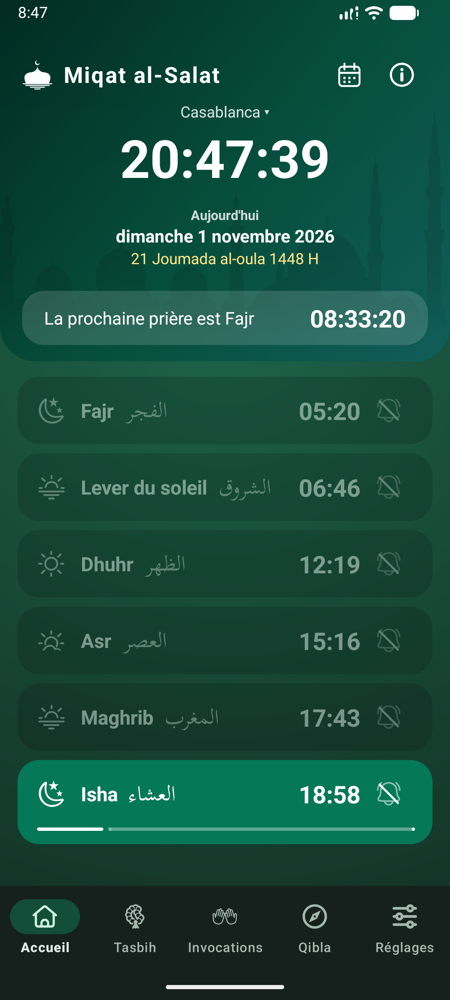
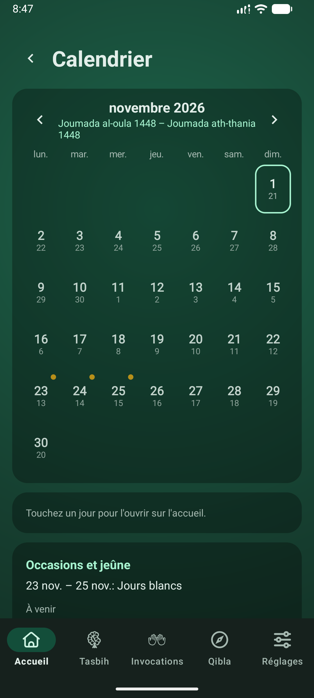
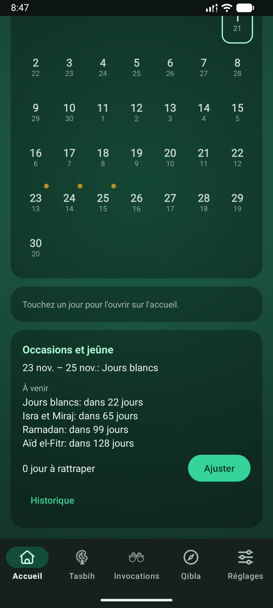
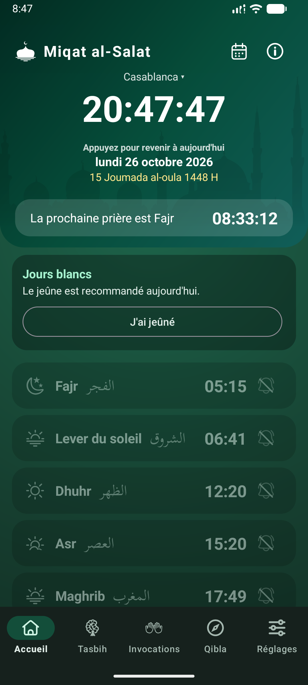
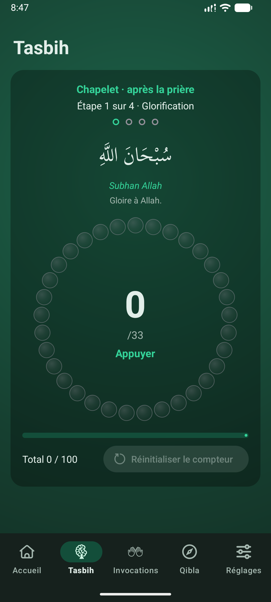
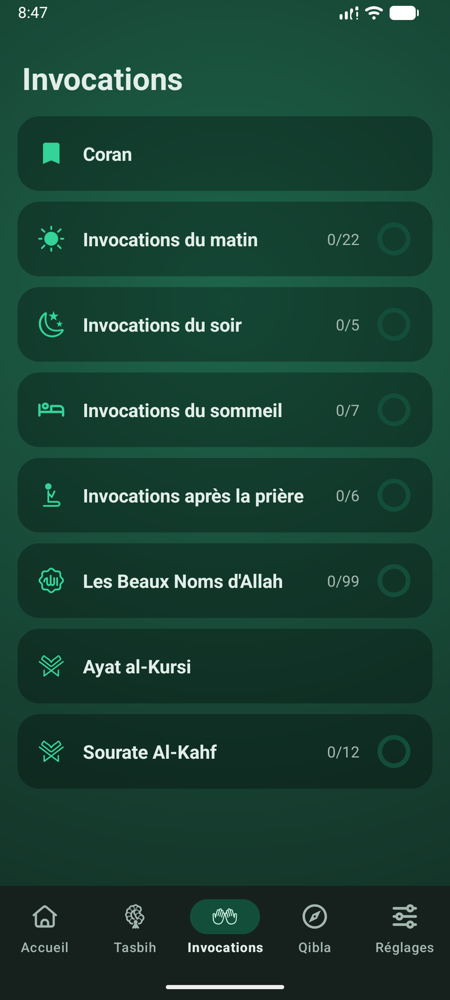
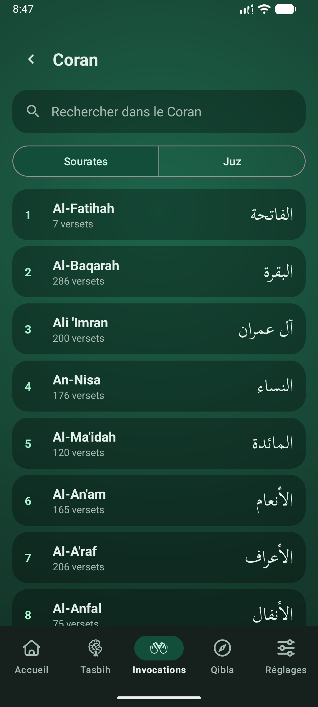
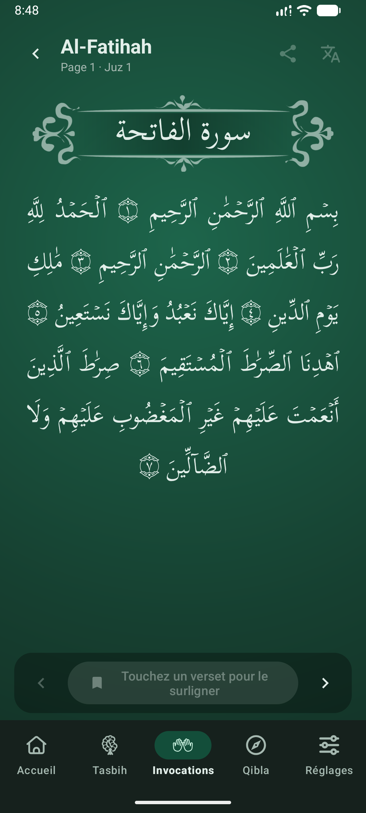
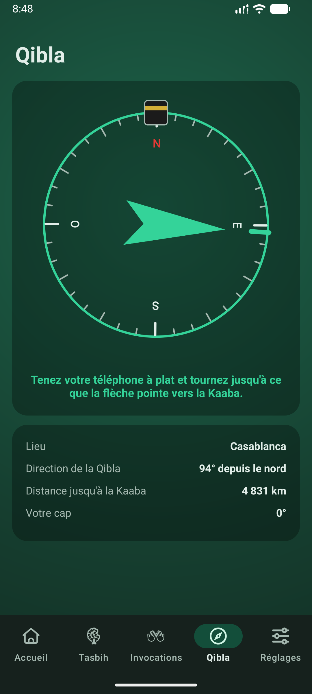
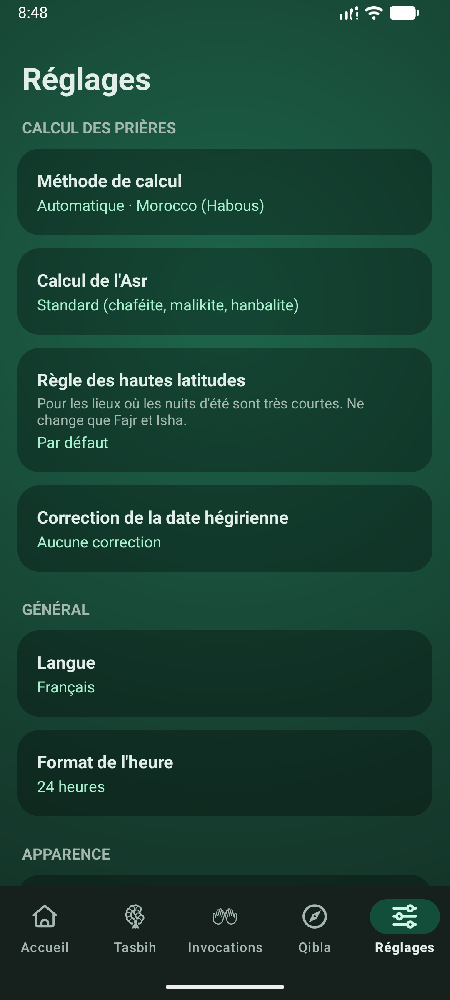

# Guide de l'utilisateur Miqat al-Salat

Horaires de prière, suivi du jeûne, invocations, Qibla et Coran, le tout sur votre téléphone. Rien ne quitte votre appareil et il n'y a pas de compte.

## Accueil : les prières du jour

Le premier onglet montre l'essentiel : l'heure, la date (avec la date hégirienne en dessous) et le compte à rebours jusqu'à la prochaine prière.

- **Lignes de prière** : Fajr, lever du soleil, Dhuhr, Asr, Maghrib et Isha. La ligne de la prière en cours est mise en évidence, avec une barre qui montre le temps restant.
- **Autres jours** : balayez vers la gauche ou la droite pour voir le jour suivant ou précédent. Touchez la date pour revenir à aujourd'hui.
- **Lieu** : touchez le nom de la ville en haut pour choisir une autre ville ou utiliser votre position actuelle.
- **Bandeau Al-Kahf** : du coucher du soleil du jeudi à celui du vendredi, un rappel propose d'ouvrir la sourate Al-Kahf.
- Le bouton calendrier ouvre le Calendrier ; le bouton **i** affiche À propos, avec l'avertissement sur les horaires et un lien pour donner votre avis.

> **Astuce.** Touchez l'**heure** d'une prière pour la corriger de quelques minutes, par exemple pour suivre votre mosquée.

## La notification de prière

- Quand une prière commence, vous recevez une seule notification. Chaque nouvelle remplace la précédente : il n'y en a jamais qu'une à l'écran.
- La notification d'une prière reste affichée jusqu'à ce que vous touchiez **J'ai prié**, touchiez la notification ou ouvriez l'accueil de l'application ; si l'accueil est déjà ouvert à son arrivée, elle disparaît après quelques secondes. Rien n'est enregistré : c'est un simple rappel.
- Touchez la **cloche** pour choisir si cette prière déclenche une alerte.
- Le lever du soleil et le rappel avant une prière sont des notifications ordinaires que vous pouvez faire glisser.

## Calendrier

Un mois d'un coup d'œil. Sous chaque numéro de jour se trouve le jour hégirien.

- Utilisez les flèches pour changer de mois ; touchez un jour pour l'ouvrir dans Accueil.
- Un 🟡 **point doré** en haut à droite marque une occasion islamique (voir Jeûne).
- Une petite marque en haut à gauche indique le jeûne du jour : 🟢 jeûné, 🔵 rattrapé, et un ⭕ anneau rouge pour un jour de Ramadan non jeûné.
- Sous la grille : la carte des occasions.

 

## Occasions et jeûne

L'application marque ces dates du calendrier islamique : Ramadan, Aïd el-Fitr, Aïd el-Adha, Nouvel An hégirien, Achoura, Mawlid, Isra et Miraj, le jour d'Arafat et les jours blancs (les 13, 14 et 15 de chaque mois). Le Mawlid et l'Isra et Miraj sont indiqués comme de simples dates.

- Les jours de **Ramadan**, la carte d'Accueil affiche le numéro du jour avec **J'ai jeûné** et **Non jeûné**. Un jour non jeûné s'ajoute aux jours à rattraper.
- Les jours recommandés (Arafat, Achoura, jours blancs), la carte propose **J'ai jeûné**.
- Les jours des deux Aïds et les trois jours qui suivent l'Aïd el-Adha, la carte indique que le jeûne n'est pas permis et ne propose rien à enregistrer.
- Quand vous avez des jours à rattraper, **J'ai rattrapé un jour** en enregistre un sur n'importe quel jour ordinaire et diminue le compteur.
- Touchez de nouveau un bouton pour l'annuler. Les jours à venir ne peuvent pas être enregistrés.
- Dans le Calendrier, **Ajuster** permet d'ajouter des jours dus des années précédentes (ou d'en retirer).
- Dans le Calendrier, **Historique** liste, pour chaque année hégirienne, les jours jeûnés, rattrapés et manqués.
- Un rappel arrive la veille au soir du premier jour de Ramadan, d'Arafat, d'Achoura et de chaque jour blanc. Vous pouvez le désactiver dans Réglages.

> **Astuce.** La date hégirienne suit le calendrier Umm al-Qura. Si votre pays commence le mois un jour plus tôt ou plus tard, réglez la correction hégirienne dans Réglages : toutes les dates suivent.

## Tasbih

Un chapelet pour compter. Touchez pour avancer d'une perle. Le cycle fait 33, 33, 33 puis 1, et votre compte est mémorisé.

## Dhikr

Des listes d'invocations avec un cercle qui se remplit au fur et à mesure. Ouvrez une liste, lisez chaque élément et passez au suivant.

- Invocations du **matin**, du **soir**, du **coucher** et **après la prière**, et les **99 Beaux Noms**.
- Les listes quotidiennes recommencent au Maghrib.
- **Ayat al-Kursi** et la **sourate Al-Kahf** s'ouvrent dans le lecteur du Coran, limités à ce verset ou à cette sourate. Al-Kahf est comptée en 12 parties et recommence chaque jeudi soir.
- La carte **Coran** en haut ouvre le Coran complet.

## Coran

- Choisissez une sourate ou un juz dans la liste, ou cherchez. Une recherche comme **2:255** mène directement à ce verset.
- Balayez ou utilisez les flèches pour tourner les pages. Le texte est grand et adapté à la largeur de votre téléphone.
- **Touchez un verset** pour le surligner. Vous pouvez ensuite le partager, ou toucher le bouton de traduction pour le lire en anglais ou en français avec sa source.
- L'endroit où vous vous êtes arrêté est mémorisé.

> **Astuce.** Le bouton de traduction reste grisé tant qu'aucun verset n'est sélectionné.

 

## Qibla

Une boussole qui indique la direction de la Kaaba depuis l'endroit où vous êtes. Tenez le téléphone à plat ; la flèche tourne quand vous tournez. Éloignez-vous du métal et des aimants, et faites un huit avec le téléphone s'il demande un étalonnage.

## Réglages

- **Calcul** : la méthode (dont celle du ministère marocain), Asr standard ou hanafite, une règle pour les nuits d'été très courtes (loin de l'équateur), et la correction hégirienne.
- **Langue** : anglais, français ou arabe (de droite à gauche).
- **Apparence** : palette de couleurs, thème sombre, et une option qui change la couleur d'accent selon le moment de la journée.
- **Alertes** : voir ci-dessous.
- **Avancé** : altitude et ajustement en minutes pour chaque prière.

Un **widget** d'écran d'accueil affiche la prochaine prière ; ajoutez-le depuis le sélecteur de widgets de votre téléphone.

## Alertes

- **Alertes de prière** à chaque heure de prière, et un rappel facultatif quelques minutes avant.
- Rappels **Al-Kahf** le jeudi soir et le vendredi après-midi, sauf si vous l'avez déjà lue.
- Rappels du **jeûne** la veille au soir de Ramadan, d'Arafat, d'Achoura et des jours blancs.
- L'interrupteur **Suivi du jeûne** dans Réglages active ou désactive les boutons de jeûne et les marques du calendrier ; les occasions restent.
- L'interrupteur **Jeûnes surérogatoires** (désactivé par défaut) propose aussi « J'ai jeûné » les lundis et jeudis et les jours de Chawwal après l'Aïd.
- **Exporter le suivi du jeûne** l'enregistre dans un fichier à conserver ou à transférer sur un autre téléphone ; **Importer un suivi du jeûne** remplace le suivi actuel par un tel fichier, après confirmation.
- **Son en mode silencieux** joue les alertes de prière même quand le téléphone est en silencieux ou en vibreur (désactivé par défaut).
- **Son des alertes** permet de choisir un fichier audio du téléphone (10 Mo au plus) pour les alertes de prière, de l'écouter ou de revenir au son par défaut.
- Chaque type a son propre interrupteur. **Son et vibration** ouvre la page du téléphone pour le son.
- Si les alertes semblent en retard ou absentes, la liste de fiabilité des alertes dans Réglages montre ce qui les bloque (autorisation, alarmes exactes, économie de batterie) avec un bouton pour corriger chacun.

> **Astuce.** Les horaires sont calculés et peuvent différer légèrement de ceux de votre mosquée. Ajustez une prière de quelques minutes si besoin.
